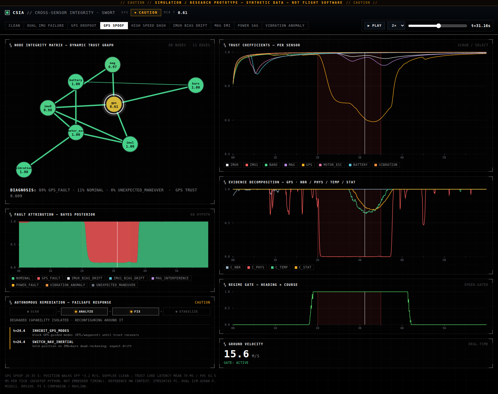
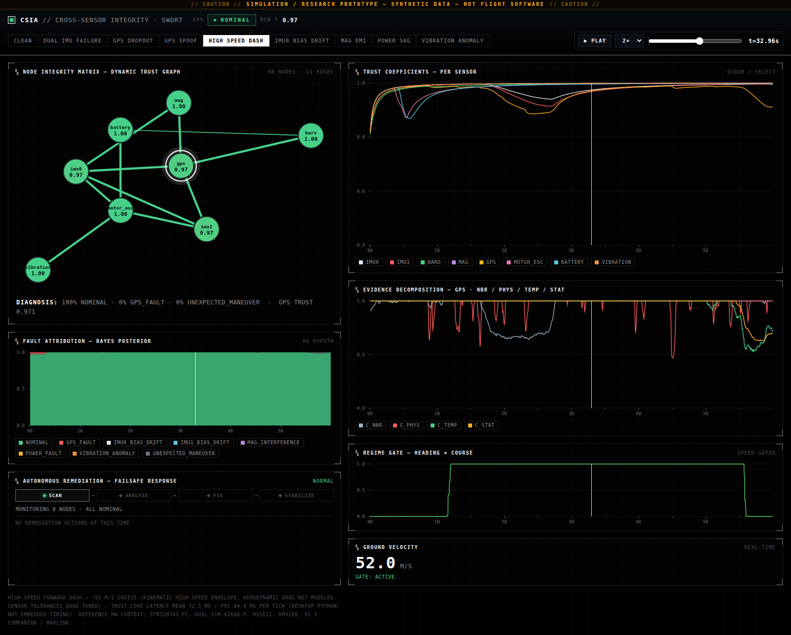

# CSIA Trust Layer

The CSIA Trust Layer monitors the sensors of an autonomous aircraft in real
time. It checks each sensor against physical models, its own recent history,
and the other sensors it is physically related to; keeps a continuously
updated trust score for every sensor; and, when something looks wrong, reports
how likely each possible cause is instead of raising a single fault flag.

This repository is the working demonstration of SWORT LLC's
**Cross-Sensor Intelligence Architecture (CSIA)**.

## What it does

- **Scores every sensor.** Each sensor carries a Trust Coefficient between 0
  and 1: a recursive Bayesian belief with adaptive forgetting, updated on
  every 25 Hz tick.
- **Reasons over physical relationships.** Instead of naive weighted-average
  sensor fusion, sensors form a Dynamic Trust Graph whose edges encode the
  physical relationships between them (8 nodes and 11 edges in the production
  graph). A relationship counts as evidence only inside its domain of
  validity.
- **Diagnoses causes.** Anomaly output is a probability distribution over
  causes (for example, "89% GPS fault, 11% nominal"), never a binary fault
  flag.
- **Recommends a response.** A deterministic, auditable failsafe state machine
  (NORMAL → CAUTION → CRITICAL → EMERGENCY) maps trust and diagnosis to
  failsafe actions.
- **Sits beside the autopilot.** PX4 or ArduPilot flies the aircraft; the
  trust layer is intended to run on the companion computer and consume MAVLink
  telemetry. GPS is judged from the raw receiver stream, not from the
  autopilot's fused output.

## Status

Version 0.8.0. The trust layer is deployable companion-computer software that
runs in an advisory role. It has been validated in simulation, on real
(unannotated) flight logs, and against a live SITL autopilot. **It has not yet
been flown in the loop, and it is not certified flight-critical software.**

- The runtime path is engineered for real deployment: armed-state gating,
  MAVLink stream reconnection, flight-controller reboot recovery, per-sample
  crash containment, monitor self-health reporting, soak-tested state
  stability, and a systemd deployment package in [`deploy/`](deploy/).
- Every failsafe output is advisory by default. Nothing commands the vehicle
  unless that is explicitly and separately enabled.
- [Path to flight](#path-to-flight) lists the exact gates between this
  repository and the airframe.
- Certified flight-critical use (DO-178C/DO-254 on qualified hardware) is a
  separate program that this repository does not claim.

<p align="center">
  
  <br>
  <sub>Dashboard replay of the simulated GPS-spoof scenario (synthetic data).</sub>
</p>

## Quick start

```sh
python3.13 -m venv .venv
.venv/bin/pip install -e ".[dev]"

# Live runtime and dashboard in one process.
# Then open http://127.0.0.1:8017 and select the LIVE tab.
.venv/bin/csia service
```

To see the dashboard without a server, open
[`dashboard_standalone.html`](dashboard_standalone.html) from a clone in any
browser. It is a self-contained build with all nine scenario replays embedded.

Other commands:

```sh
.venv/bin/csia run --scenario gps_spoof                               # runtime only, simulated source
.venv/bin/csia run --source mavlink --conn udp:0.0.0.0:14550          # live vehicle or SITL
.venv/bin/csia run --profile sow001_quad_strict --scenario power_sag  # run under a platform profile's failsafe posture
.venv/bin/csia serve                                                  # dashboard on replays only
.venv/bin/csia report                                                 # detection and diagnosis summary, all scenarios
.venv/bin/python -m pytest                                            # full test suite
```

SOW001 is the baseline quadrotor build that the simulated sensor models
mirror; its flight controller is under development (see
[Hardware context](#hardware-context-and-integration-path)). The
`sow001_quad_strict` profile applies a stricter failsafe posture (faster
escalation, slower recovery) to the same airframe.

### Run on your own data

```sh
pip install -e ".[logs]"                                # adds pyulog
csia analyze-logs "path/to/*.ulg" --out report.json    # any PX4 .ulg log (e.g. a QGroundControl download)
csia run --source mavlink --conn udp:127.0.0.1:14551   # live vehicle or SITL
python tools/sitl_validate.py                          # end-to-end SITL check
```

Real-world runs use `OnlineTrustLayer(field_mode=True)`, the real-world
tolerance package. It adds adaptive residual normalization (each airframe
learns its own noise floor), χ²-tail tolerance, anti-alias downsampling,
mag-aided yaw, self-calibrated field magnitude, minimum-rate channel
screening, and monitored-sensor-aware failsafe rules. Every one of these was
forced into existence by real logs, and all of them are tested.

## Key results

Results for v0.8.0. Each row is expanded, with its full caveats, under
[Validation evidence](#validation-evidence).

| Evidence | Result | Details |
|---|---|---|
| Simulated fault harness (5 synthetic scenarios, CI-gated) | GPS spoof: 4.4 s to operator alert, 89% GPS-fault diagnosis. IMU isolation 99% / 0%; mag, power, vibration 100%. A regression contract, not independent detection evidence. | [Metric definitions](docs/validation/METRIC_DEFINITIONS.md) |
| Campaign reproducibility (`csia bench`, `csia mc`, seeker Monte Carlo) | Bit-identical to committed results after the 2026-07 live-path hardening | [Monte Carlo results](deliverables/montecarlo_results.md) |
| Soak test | 3.1 h flight-equivalent: 0 errors, +0.0 MB RSS, latency ratio 1.01x | [`tools/soak.py`](tools/soak.py) |
| Real flight data (26 public PX4 logs, unannotated) | No alert in 24 of 26 logs; 3.86 episodes per monitored hour (95% CI 0.47–13.94). ~30-fold uncertainty; not a reliability claim. | [Provenance audit](docs/audit/CSIA_DATASET_PROVENANCE_AUDIT.md) |
| ArduPilot SITL mission | Pass: 6 sensors, min trust 0.78, zero false alarms, landed\* | [`sitl_validate.py`](tools/sitl_validate.py) |
| SITL GPS fault injection | Pass: glitch and fix kill detected from the raw stream\* | [`sitl_validate.py`](tools/sitl_validate.py) |
| Native C core | 674 ns/tick on a desktop host. Not measured on target; not on any production execution path. | [Native runtime status](docs/embedded/NATIVE_RUNTIME_STATUS.md) |

\* The SITL results were measured before the 2026-07
armed-state/vz/reboot hardening and must be refreshed before any new claim.

## Documentation

- **Deployment and embedded readiness:**
  [hardware deployment guide](docs/HARDWARE.md) ·
  [hardware validation plan](docs/hardware_validation.md) ·
  [embedded checklist](docs/embedded_checklist.md) ·
  report templates ([latency](docs/latency_report_template.md),
  [reliability](docs/reliability_report_template.md)) ·
  [native runtime status](docs/embedded/NATIVE_RUNTIME_STATUS.md)
- **Validation and metrics:**
  [metric definitions](docs/validation/METRIC_DEFINITIONS.md) ·
  [held-out validation protocol](docs/VALIDATION_PROTOCOL.md) ·
  [dataset provenance audit](docs/audit/CSIA_DATASET_PROVENANCE_AUDIT.md) ·
  [exposure precision plan](docs/validation/EXPOSURE_PRECISION_PLAN.md) ·
  [latency path audit](docs/audit/CSIA_LATENCY_PATH_AUDIT.md)
- **Transition engineering package** (prepared for Army xTech and SBIR
  reviewers): [requirements](docs/requirements/requirements.md) ·
  [traceability matrix](docs/traceability/traceability_matrix.md) ·
  [evidence matrix](docs/evidence/evidence_matrix.md) ·
  [TRL assessment](docs/TRL_ASSESSMENT.md) ·
  [transition report and audit](docs/TRANSITION_REPORT.md) ·
  [validation hardware BOM](docs/HARDWARE_BOM.md)
- **Reviews and commercialization:**
  [engineering review](docs/ARCHITECTURE_REVIEW.md) (adversarial, scored) ·
  [commercial and SBIR readiness](docs/COMMERCIALIZATION.md) ·
  [changelog](CHANGELOG.md)

## Real-time runtime

The runtime (`csia.runtime`) is the deployable software. `csia run` starts the
actual product path, not a replay:

```
SourcePlugin ──samples──▶ OnlineTrustLayer ──TrustState/tick──▶ FailsafePolicy ──actions──▶ Actuators
(MAVLink | simulator)     (25 Hz, causal)     (trust + diagnosis)  (state machine)   (log | MAVLink)
```

### Components

- **`OnlineTrustLayer`** ingests one sample at a time and emits a `TrustState`
  on every 25 Hz tick: 8 Trust Coefficients, evidence sub-scores, and the
  diagnosis posterior. It shares the exact per-tick cores (`TrustCore`,
  `DiagnosisCore`) with the batch pipeline, and
  `tests/test_runtime.py::test_online_matches_batch` pins the two together:
  converged divergence is below 0.01, and the only transient difference
  (causal versus retroactive IMU ground calibration) must decay.
- **Source plugins** (`csia/runtime/plugins.py`):
  - `SimulatedFlightSource`: the bench source, for any catalog scenario.
  - `MavlinkSource`: the SOW001 stack, a Raspberry Pi 5 companion consuming
    `HIGHRES_IMU`, `SCALED_IMU2`, `SCALED_PRESSURE`, `GLOBAL_POSITION_INT`,
    `ESC_STATUS`, `BATTERY_STATUS` and `VIBRATION`. Requires
    `pip install "csia-trust-layer[mavlink]"`. Marked experimental until
    validated against the real flight controller's units and frames.
- **`FailsafePolicy`** (`csia/runtime/failsafe.py`) is the critical-mission
  emergency plan: a deterministic, auditable state machine
  (NORMAL → CAUTION → CRITICAL → EMERGENCY) with per-condition dwell (no
  single-tick flapping), de-escalation hysteresis, and a 10 s arming delay
  (for ground checks, calibration and prior convergence). Measured behavior:

  | Scenario | Failsafe response |
  |---|---|
  | `clean` | NORMAL for the whole flight, zero transitions |
  | `gps_spoof` | CAUTION at 24.4 s: `SWITCH_NAV_INERTIAL` + `INHIBIT_GPS_MODES`; back to NORMAL after the spoof ends |
  | `power_sag` | CRITICAL at 33.8 s: `REDUCE_POWER` + `LAND_NOW`; recovers |
  | `dual_imu_failure` | CRITICAL (`PREPARE_LANDING`), then EMERGENCY at 49.2 s: `STABILIZE` on the best IMU + `CONTROLLED_DESCENT` (1.5 m/s) + `BROADCAST_MAYDAY` |

  The `dual_imu_failure` response is the "drone stabilizes and brings itself
  down" contract.
- **Actuators:** `LoggingActuator` (the default; advisory output) and
  `MavlinkActuator` (opt-in with `enable_commands=True`; maps
  `CONTROLLED_DESCENT`/`LAND_NOW` to autopilot LAND, and so on; validate in
  SITL first).

### Runtime cost

- The reference Python runtime costs ~140 µs per tick, 0.35% of the 40 ms tick
  budget at 25 Hz. Alert latency is set by evidence statistics and the
  dwell/threshold policy, not by code speed.
- The **native C core** (`csia/native/`) implements the same algorithm,
  parity-pinned to 1e-12 on the production 8-node/11-edge graph, and runs the
  trust and diagnosis math in 674 ns per tick on a desktop host. It is sized
  for the STM32H743 but **is not currently on any production execution path
  and has never been measured on target**. The Python runtime is what
  executes. See [native runtime status](docs/embedded/NATIVE_RUNTIME_STATUS.md).

### Robustness

- **Raw-sensor monitoring.** The GPS node consumes `GPS_RAW_INT`, not the
  EKF's fused output. The autopilot's estimator innovation-gates faults out of
  its own output stream, hiding exactly what an integrity monitor exists to
  catch. This was proven in SITL: a 55 m glitch is invisible in the fused
  output and caught from the raw stream.
- **Silence watchdog.** A sensor that stops producing samples is declared
  not-fresh within ~5 sample periods and handled by the failsafe. Stale
  values are never silently held (tested).
- **Armed-state gating.** The motor edges and the failsafe key on the
  vehicle's actual armed flag (MAVLink `HEARTBEAT` or ULog `vehicle_status`)
  when the source provides it. A vehicle idling disarmed on the ground cannot
  poison its motor edges with gravity-versus-zero-thrust evidence, and the
  failsafe never acts on a disarmed vehicle. The t > 5 s proxy remains only as
  the simulator bench fallback (both behaviors tested).
- **No fabricated measurements.** `GPS_RAW_INT` carries no vertical velocity,
  so the mapping marks `vz_valid=False` and every GPS check judges horizontal
  components only (degrees of freedom adjusted). A steady climb no longer
  reads as a spoof-like vertical residual (tested).
- **Reboot and time-jump hardening.** A flight-controller reboot re-anchors the
  MAVLink epoch monotonically instead of dropping all post-reboot data. Any
  source time discontinuity resets the trust layer and failsafe dwell timers
  instead of integrating a negative dt (tested; `tools/soak.py` loops hours of
  flight time through the reset path and watches RSS and latency).
- **Stream resilience.** `MavlinkSource` reconnects with capped backoff on
  timeout or connection error, preserving the time epoch and GPS origin across
  the gap, so an in-flight monitor never gives up on its stream. The stale
  watchdog and the failsafe report the outage while it retries.
- **Self-health.** Every JSONL state line carries the monitor's own health
  (contained errors, rejected malformed samples), and `RunSummary` reports the
  same, so the log answers "who watches the watchman" (tested).

### Outputs and deployment

- **State log.** `--log run.jsonl` streams one JSON line per tick (trust,
  level, diagnosis, actions) for the ground control station or post-flight
  analysis.
- **Deployment package.** `sudo deploy/install.sh` installs the hardened
  systemd unit ([`deploy/csia.service`](deploy/csia.service): advisory only,
  `Restart=always`, no privileges, logs to `/var/log/csia/`) on the companion
  computer.
- **`csia service`** runs the runtime and the dashboard in one process. The
  dashboard's LIVE tab renders the runtime's trust and diagnosis feed with a
  1 Hz refresh, while replay tabs remain available for analysis.

### Platform profiles

The trust mathematics is platform-agnostic. A `VehicleProfile`
(`csia/profiles.py`) bundles the sensor set, tick rate, engine tuning and
failsafe posture. `sow001_quad` and `sow001_quad_strict` ship today; the
extension contract for new platforms (rover, USV, industrial sensor networks)
is documented in the module.

## Architecture

Traceability from the CSIA research description to the implementation:

| CSIA concept | Implementation | Module |
|---|---|---|
| Dynamic Trust Graph (sensors as nodes, physical relationships as edges) | 8 nodes / 11 edges; each edge carries a relation from the source description | `csia/trust_graph/` |
| Physics-based prediction | Internal self-models per sensor (GPS pos-derivative vs Doppler, battery V=OCV−IR, motor I∝rpm³, …) | `csia/prediction/comparator.py` |
| Historical-trend prediction | Holt level+trend one-step forecast + innovation-whiteness statistic | `csia/prediction/predictors.py` |
| Neighbor-sensor prediction | Edge residuals h_ij(z_i, z_j), χ²-normalized per degree of freedom | `csia/prediction/comparator.py` |
| Trust Coefficient (0–1, recursive Bayesian, adaptive forgetting) | Beta(α, β) belief per node; ρ ∈ [0.95, 0.998] driven by predictor disagreement; natural recovery | `csia/trust_engine/engine.py` |
| Graceful degradation, not binary failure | Evidence fusion over 4 sub-scores; gated checks contribute *nothing* (not "consistent") outside their validity regime | engine + comparator |
| Probability distribution over causes | Gate-aware naive Bayes over the consistency signature (e.g. "89% GPS fault, 11% nominal") | `csia/diagnosis/bayes.py` |
| Sensor simulation with injectable faults | Dual ICM-42688-P, MS5611, RM3100, GPS (spoof/dropout), ESC, battery, 1 kHz vibration; 6 fault kinds, validated specs | `csia/sensors/` |
| Dashboard / scenario replay | Static matplotlib + local web app (stdlib server, zero JS dependencies) | `csia/dashboard/` |
| Test harness | pytest: unit + scripted fault scenarios with detection/attribution/isolation/recovery assertions and measured latency | `tests/` |

A physical relationship is only evidence inside its domain of validity. The
key regime gates:

- **Mag-Heading ↔ GPS-Course is speed-gated:** zero weight at ≤ 2 m/s, full
  weight at ≥ 3 m/s, because a quadrotor's heading is not slaved to its
  velocity vector.
- The IMU attitude filter's accelerometer correction is quasi-static-gated.
- GPS checks gate on fix validity.
- Motor edges gate on armed state.

## Production properties

- **Causal by construction.** Every derivative on a measurement stream is a
  strict backward difference; every filter (EW, Holt, complementary attitude,
  Beta recursion) is forward-only.
  `tests/test_comparator.py::test_causality_no_lookahead` proves that outputs
  up to time T are bit-identical with or without data after T. The batch
  implementation is therefore an exact replay of an online sample-by-sample
  loop, ready to port to the companion computer.
- **Deterministic.** All scenario seeds are fixed; the test suite asserts
  bit-for-bit stream reproducibility.
- **Validated inputs.** Unknown fault kinds or targets and invalid engine
  configurations raise immediately instead of being silently ignored.
- **No magic numbers in the loop.** Engine tunables live in `EngineConfig`;
  comparator σ values are documented noise budgets per check.
- **Measured, clearly labeled latency.** ~85 µs per tick for the trust core
  (mean, 8 nodes / 11 edges, desktop Python). This is not embedded timing,
  and the measured window currently includes replay marshalling as well as
  the trust core itself (audit F-08).

## Validation evidence

Status as of v0.8.0. This section expands each row of
[Key results](#key-results).

### Simulated fault harness

Five scripted fault scenarios in [`tests/scenarios/`](tests/scenarios/),
gated in CI.

- The faults are synthetic injections, not real faults. Assertion bounds are
  regression contracts set below previously measured performance, so passing
  indicates no regression; it is not independent detection evidence.
- GPS spoof: 2.2 s to trust < 0.85 and 4.4 s to operator alert, with 89%
  GPS-fault diagnosis. IMU isolation 99% / 0%. Magnetometer, power and
  vibration: 100%.
- Both latencies are reported because they are not the same quantity
  ([metric definitions](docs/validation/METRIC_DEFINITIONS.md), §3).

### Campaign reproducibility

`csia bench`, `csia mc` (150 runs) and the seeker Monte Carlo were regenerated
after the 2026-07 live-path hardening. The output is bit-identical to the
committed [`campaigns/*.json`](campaigns/) and
[`deliverables/montecarlo_results.*`](deliverables/montecarlo_results.md): the
hardening changed no validated behavior.

### Soak test

[`tools/soak.py`](tools/soak.py) loops the runtime through the reset path.
Result: 185 passes, 3.1 h flight-equivalent: 277,500 ticks, 0 errors,
+0.0 MB RSS, latency ratio 1.01x.

### Real flight data

26 public PX4 logs, analyzed with `csia analyze-logs`. **The logs are
unannotated.**

- No CSIA alert episode occurred in 24 of the 26 logs.
- 2 alert episodes across 0.518 monitored flight-hours: 3.86 episodes per
  hour, 95% CI 0.47–13.94.
- Exposure is *monitored* time (after `arm_time`). Raw log duration (0.663 h)
  overstates it by 21.8%, because no alert can be raised inside the arm
  window.
- Verified-healthy exposure: 0.000 h. These logs carry no annotation, and
  CSIA's silence is not evidence of health.
- Held-out exposure: 0.000 h. All 26 logs were used to shape `field_mode`
  (the real-world tolerance package) and the offline failsafe posture.
- ~30-fold uncertainty; this is not a reliability claim.

See the [dataset provenance audit](docs/audit/CSIA_DATASET_PROVENANCE_AUDIT.md)
and the [exposure precision plan](docs/validation/EXPOSURE_PRECISION_PLAN.md).

The [held-out validation protocol](docs/VALIDATION_PROTOCOL.md) closes
review finding C2 in the [engineering review](docs/ARCHITECTURE_REVIEW.md):
the public-log false-alarm rate was tuned and reported on the same 26 flights.
`tools/fetch_real_logs.py` re-downloads the 26-log campaign by UUID and re-runs
it in one command.

### ArduPilot SITL

[`tools/sitl_validate.py`](tools/sitl_validate.py) flies a full autonomous
mission over live MAVLink.

- **Mission: pass.** 6 sensors monitored, min trust 0.78, zero false alarms,
  landed.
- **Fault injection (`--inject gps_glitch`): pass.** A GPS glitch and a GPS
  fix kill were injected into the real autopilot mid-flight. Both faults were
  detected live from the raw receiver stream (GPS trust 0.99 → 0.70, nav
  CAUTION raised).
- These results were measured before the 2026-07 armed-state/vz/reboot
  hardening and must be refreshed before any new claim (step 1 of
  [Path to flight](#path-to-flight)).

### Native C core

`csia/native/csia_core.c`: C, zero-allocation, parity-pinned to Python at
1e-12 on the production 8-node/11-edge graph.

- Host benchmark: trust kernel 247 ns + diagnosis 427 ns per tick on a
  desktop.
- The 7–15 µs STM32H743 figure and 0.04% CPU are estimates, not target
  measurements.
- The C core is not on any production execution path; the Python runtime is
  what executes. See [native runtime status](docs/embedded/NATIVE_RUNTIME_STATUS.md).

## Scenario results

Fixed seeds, from `csia report`. Two latencies are reported because they
differ by 2–2.7x and must not be conflated (see
[metric definitions](docs/validation/METRIC_DEFINITIONS.md) §3 and the
[latency path audit](docs/audit/CSIA_LATENCY_PATH_AUDIT.md)):

- **Time to trust < 0.85 (analysis only).** Detector-internal; the analysis
  threshold triggers nothing. Retained for historical continuity.
- **Time to alert (operator-facing).** Onset to the first failsafe alert
  episode, which additionally requires the per-class production threshold,
  `dwell_up` and `arm_time`. This is the number comparable to a PX4/ArduPilot
  health flag.

| Scenario | Target | Min trust | To trust < 0.85 (analysis) | **To alert (operator)** | Peak diagnosis |
|---|---|---|---|---|---|
| `clean` | — | 0.92 (no false alarm) | — | — | 98% nominal |
| `gps_spoof` | gps | 0.59 | 2.2 s | 4.4 s (CAUTION) | 89% gps_fault |
| `gps_dropout` | gps | 0.89 (trust holds) | n/a | n/a | 98% nominal (absence of data ≠ fault) |
| `imu0_bias_drift` | imu0 | 0.77 (imu1 stays 0.86) | 13.0 s (slow ramp) | never alerts † | 99% imu0_bias_drift, 0% imu1 |
| `mag_emi` | mag | 0.28 | 1.5 s | 3.9 s (CAUTION) | 100% mag_interference |
| `power_sag` | battery | 0.40 | 1.4 s | 3.4 s (CRITICAL) | 100% power_fault |
| `vibration_anomaly` | vibration | 0.17 | 2.2 s | 5.8 s (CRITICAL) | 100% vibration_anomaly |
| `dual_imu_failure` | imu0/imu1 | 0.44 | 6.4 s | (see scenario) | 99% imu0_bias_drift, 1% imu1 (failsafe → stabilize + descent) |
| `high_speed_dash` ‡ | — | 0.89 (no false alarm) | — | — | 100% nominal |

† **`imu0_bias_drift` raises no operator alert at any time.** `imu0` degrades,
but the attitude condition reads `max(imu0, imu1)` and `imu1` stays healthy at
≈0.86, above `att_caution` 0.82: redundancy working as designed. The 13.0 s
figure is a trust crossing with no operator-visible consequence; diagnosis
still isolates `imu0` correctly (at 15.1 s). It is not a detection event, and
it was previously published as if it were.

‡ `high_speed_dash` flies a different truth profile (`fast_cruise`, peak
ground speed 52.0 m/s) instead of the shared hover/circle baseline. Its
purpose is to exercise the velocity readout and the speed-gated
Mag-Heading ↔ GPS-Course edge at an elevated envelope; the trust layer flies
it clean (min trust 0.89, failsafe NORMAL throughout). **Caveat:** the flight
is kinematic only. Aerodynamic drag is not modeled and sensor tolerances
remain quad-tuned, so this is a regime-envelope demo, not a validated
high-speed flight-dynamics model. Because `csia report` deliberately runs
every scenario against the shared baseline truth for an apples-to-apples
comparison, the 0.89 figure above comes from the scenario's own profile (as
rendered in the dashboard replay), not from the `csia report` shared-truth
row.

## Dashboard

The web dashboard is a tactical cross-sensor console. It renders the live
trust graph, per-sensor trust coefficients, Bayesian fault attribution, the
regime gate, ground velocity, and the autonomous-remediation response loop.

A fully self-contained, zero-dependency build embedding all nine scenario
replays is committed at [`dashboard_standalone.html`](dashboard_standalone.html).
Open it directly in any browser; no server is required. Rebuild it with
`python tools/build_standalone_dashboard.py`.

The GPS-spoof replay (fault detected) is shown near the top of this page. The
high-speed dash replay (52 m/s, clean):



## Hardware context and integration path

Sensor models mirror the SOW001 flight controller under development: an
**STM32H743VIT6** flight controller with dual **ICM-42688-P** IMUs, an
**MS5611** barometer, an **RM3100** magnetometer, and a **Raspberry Pi 5**
companion computer on **MAVLink**.

The intended integration: PX4 or ArduPilot flies the aircraft; the CSIA Trust
Layer runs on the companion computer, consuming MAVLink telemetry
(`HIGHRES_IMU`, `ESC_STATUS`, `GPS_RAW_INT`, `BATTERY_STATUS`, …) and
publishing per-sensor trust and diagnosis for the ground station and, later,
for fusion-weight adaptation. The causality guarantee (see
[Production properties](#production-properties)) is what makes that port
mechanical rather than a rewrite.

For deployment on hardware, [docs/HARDWARE.md](docs/HARDWARE.md) covers the
SOW001 wiring, telemetry and commissioning; the systemd service; the mandatory
sigma-calibration procedure; and the Tier 2/3 scaling builds (RTK, third IMU,
optical flow, Jetson with visual-inertial odometry, non-aircraft use).

## Path to flight

The runtime runs on the vehicle today, in an advisory role on the companion
computer. These are the gates between this repository and the airframe, in
order. Each is a measurement campaign, not a rewrite.

1. **Re-run SITL on current code** (`tools/sitl_validate.py`, then
   `--inject gps_glitch`). The SITL results in [Key results](#key-results)
   were measured before the 2026-07 armed-state/vz/reboot hardening and must
   be refreshed before any new claim.
2. **Commissioning calibration on the actual airframe:** the mandatory
   sigma-calibration procedure in [docs/HARDWARE.md](docs/HARDWARE.md)
   (`OnlineTrustLayer(auto_baseline_s=...)`).
3. **Overnight soak on the Pi 5 itself:**
   `python tools/soak.py --minutes 480`. Desktop reference: 3.1 h
   flight-equivalent, zero errors, zero growth.
4. **Advisory-only supervised flights:** `deploy/install.sh`; the service
   consumes live MAVLink, logs `state.jsonl`, and commands nothing. Compare
   post-flight logs against expectations before trusting a single number.
5. **Held-out real-log campaign** ([docs/VALIDATION_PROTOCOL.md](docs/VALIDATION_PROTOCOL.md))
   for a false-alarm rate an evaluator can't dismiss.
6. Only after all of the above: consider `MavlinkActuator` with
   `enable_commands=True`. Validate it in SITL first; range-safety rules
   apply, and it remains uncertified.

Certified flight-critical operation (DO-178C/DO-254, qualified toolchain,
target-hardware verification) is a separate, funded program; see
[docs/COMMERCIALIZATION.md](docs/COMMERCIALIZATION.md). This repository
provides the algorithm, evidence, and deployment path. It does not provide
certification.

## Known limitations

Read these before demoing.

- Comparator σ values are hand-set noise budgets from the simulation's own
  sensor models plus maneuvering headroom. On real hardware they must come
  from a ground/hover calibration campaign.
- The diagnosis is naive Bayes with a hand-built cause → signature table. It
  does not handle simultaneous independent faults gracefully: posteriors will
  split or favor the cause with more matching features.
- The truth simulator and the sensor models share the same physics constants
  (thrust law, battery IR). Real-world model mismatch will widen residuals;
  the χ²-excess scoring absorbs some of this, and σ recalibration absorbs the
  rest.
- Fault injection is telemetry-level (for example, power sag alters reported
  RPM, not the physical rotor state).
- The vibration channel is modeled at 1 kHz. A real deployment would sample at
  multiple kHz and use a proper order-tracking spectrum, not a single RMS.

Limits of the evidence, detailed under [Validation evidence](#validation-evidence):

- Not yet flown in the loop, and not certified flight-critical software.
- The real-flight-log results come from 26 unannotated public logs, with
  0.000 h of verified-healthy and 0.000 h of held-out exposure and ~30-fold
  uncertainty. They are not a reliability claim.
- The native C core has never been measured on target and is not on any
  production execution path; the STM32H743 timing figures are estimates.
- The SITL results predate the 2026-07 hardening and must be refreshed before
  any new claim.
- The simulated-harness assertions are regression contracts, not independent
  detection evidence.

## Repository layout

```
csia/                  installable package (pip install -e .)
  runtime/             real-time runtime: source plugins, online trust layer, failsafe, actuators
  native/              ctypes bindings for the native C core (csia_core.c)
  profiles.py          vehicle and platform profiles
  sensors/             synthetic sensor models + fault injection
  trust_graph/         Dynamic Trust Graph structure
  prediction/          three-predictor comparator, attitude, residuals
  trust_engine/        Beta-belief trust engine (EngineConfig)
  diagnosis/           Bayesian causal diagnosis
  dashboard/           replay export, matplotlib dashboard, web app + server
  scenarios.py         canonical scenario catalog + pipeline assembly
  validation.py        validation campaigns
  contracts/           Trust Contract v0.1 conformance validator
  metrics/, datasets/, experiments/, evidence/, data/, seeker/
                       measurement, provenance and research layers (not on the runtime path)
  cli.py               csia build | serve | report | info | run | service | analyze-logs | bench | mc
deploy/                systemd unit and install scripts for the companion computer
tools/                 SITL validation, soak, benchmarks, log fetchers, campaign runners
tests/                 unit tests + tests/scenarios/ fault harness
data/replay/           scenario replay JSONs (generated, not tracked)
data/sample_logs/      generated figures (not tracked)
phase1..3_*.py         phased demo scripts (thin wrappers over the package)
```

## Further reading

- Performance regression check: `tools/perf_regression.py` against
  `campaigns/perf_baseline.json`.
- [Organization-level 10-year blueprint](docs/ORG_BLUEPRINT.md).

## License

Proprietary software of SWORT LLC. See [LICENSE](LICENSE) for the terms.
